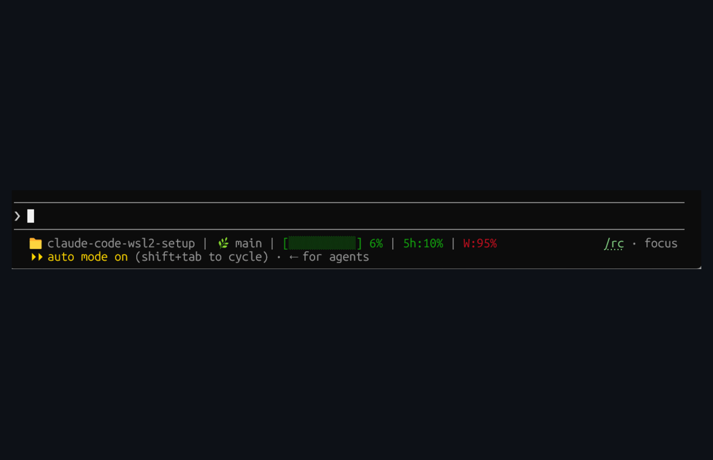
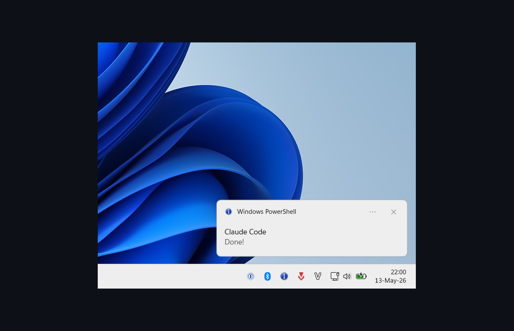
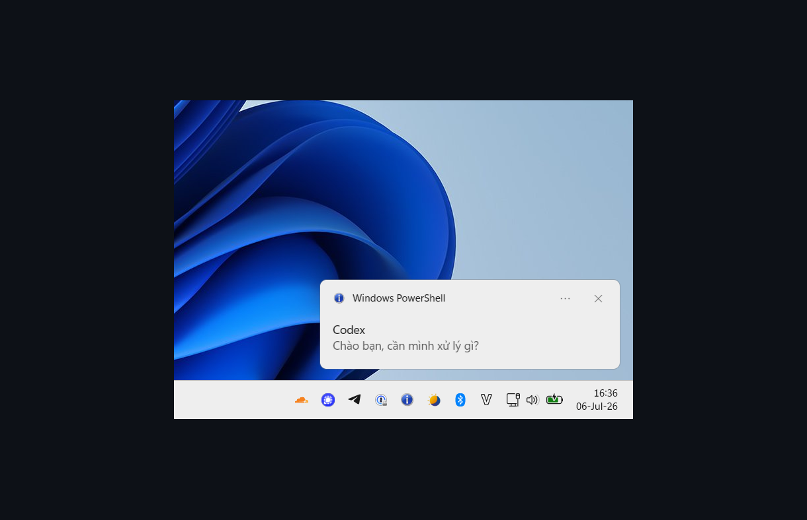
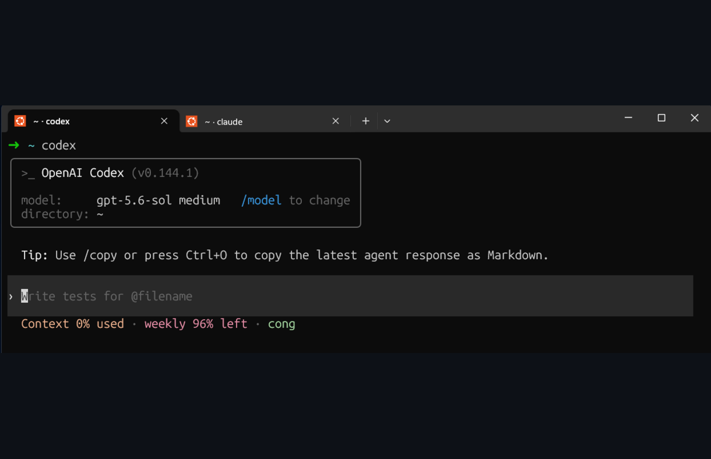

# Claude Code WSL2 Setup

The Claude Code setup I previously used with WSL2 + Windows Terminal: screenshot
paste, Windows notifications, LSP navigation, and a custom statusline.

**Maintenance status:** I now use Ubuntu + Ghostty and no longer test this setup
daily on WSL2. These guides remain available for WSL2 users. Bug reports and fixes
are welcome: use the [WSL2 issue form](https://github.com/congmnguyen/claude-code-wsl2-setup/issues/new?template=wsl2-bug.yml)
and include the output of `bash scripts/doctor.sh`. The
[verification status](maintenance.md#wsl2-verification-status) lists changes that
still need a WSL2 run.

Read [why I moved from WSL2 to Ubuntu + Ghostty](ubuntu-ghostty.md) for the context
behind the change. This repository continues to focus on WSL2.

## Who this is for

Use this if you run Claude Code from WSL2 and want the Windows side to stop feeling
bolted on: screenshots paste as WSL paths, notifications land in Windows, browser
links open in your normal browser, and the statusline shows context and usage.

Where to start, depending on what hurts most:

- **Context burn** → [`lsp-setup`](lsp-setup.md).
- **Windows/WSL friction** → [`image-paste`](image-paste.md) and [`claude-notify`](claude-notify.md).
- **No visibility into context and usage** → [`statusline`](statusline.md).

## Preview

<p align="center">
  <br>
  <em>claude-code-wsl2-setup | main | [··········] 6% | 5h:10% | W:95%</em>
</p>

<p align="center">
  <br>
  <em>Balloon tip fires on Claude Code <code>Notification</code> events, skipped when Windows Terminal is focused</em>
</p>

<p align="center">
  <br>
  <em>Codex's top-level <code>notify</code> command shows the completed turn's last reply</em>
</p>

<p align="center">
  <br>
  <em>Shell-managed titles keep Claude Code and Codex tabs distinguishable.</em>
</p>

## Setup

These instructions target WSL2 + Windows Terminal. Start with the guide for the
feature you need; optional integrations are separate choices.

```bash
git clone https://github.com/congmnguyen/claude-code-wsl2-setup.git
cd claude-code-wsl2-setup
claude
```

Then prompt:

> Help me set up this repository's WSL2 features. Check my environment, explain the
> changes, and preserve my existing settings. Leave optional components alone.

Claude can read the docs and help apply the configuration. Some steps require
changes on the Windows side; see the individual guides.

For a manual install, follow the linked setup page for the feature you want.

## What's included

### Claude Code core

| File | Fix |
|------|-----|
| [`lsp-setup.md`](lsp-setup.md) | Official LSP plugins + language servers for TypeScript, Python, Go, and Rust, so Claude uses real Go-to-Definition / find-references instead of burning tokens on broad file search |
| [`statusline.md`](statusline.md) | Project dir, git branch, context-window fill bar, and 5-hour / 7-day usage, color-coded by severity |
| [`settings.md`](settings.md) | Disabling the `Co-authored-by: Claude` git attribution and session links |

### WSL / Windows bridge

| File | Fix |
|------|-----|
| [`image-paste.md`](image-paste.md) | Copy a screenshot on Windows, paste the file path straight into Claude Code or Codex. A systemd user service keeps [wsl-screenshot-cli](https://github.com/Nailuu/wsl-screenshot-cli) running, saves shots under `/tmp/.wsl-screenshot-cli/`, and restarts the monitor if it exits. Optional Alt+V keybinding |
| [`terminal-title.md`](terminal-title.md) | Distinct zsh tab titles for the current project and active agent, such as `text2sql-agent · ✳ Claude` or `text2sql-agent · >_ Codex` |
| [`claude-notify.md`](claude-notify.md) | Windows balloon tip on Claude Code `Notification` events — Claude finished, needs permission, or a background agent completed — suppressed when Windows Terminal is already focused |
| [`codex-notify.md`](codex-notify.md) | Reuse the same balloon script through Codex's top-level `notify` command |
| [`bin/tmux-notify-run`](bin/tmux-notify-run) | Detached tmux jobs with logs, exit status, and Windows completion notification |
| [`shift-enter.md`](shift-enter.md) | Shift+Enter inserts a newline instead of submitting, in both the VSCode integrated terminal and Windows Terminal |
| [`browser.md`](browser.md) | Open links and OAuth flows in your Windows browser via `BROWSER`, plus an XDG fallback for OAuth CLIs |
| [`mcp-setup.md`](mcp-setup.md) | **Optional.** Project-scoped Figma Desktop MCP, reached from WSL2 through mirrored networking |
| [`capslock-esc.md`](capslock-esc.md) | CapsLock → Escape via a SharpKeys registry remap — works in WSL2, Vim, games, and elevated processes |

## Troubleshooting

If a hook, plugin, or other customization breaks Claude Code, start a clean diagnostic
session with `claude --safe-mode`. Use `/doctor`, `/hooks`, and `/mcp` to inspect the
installation and loaded integrations.

From the cloned repository, `bash scripts/doctor.sh` prints a read-only report of the
installed scripts, settings, and WSL2 prerequisites. It also flags known conflicts,
such as shell startup files or Claude hooks that start a second screenshot monitor.

## Maintenance and checks

See [maintenance](maintenance.md) for backups, verification, removal, and the
scope of automated checks. Windows behavior still needs testing on WSL2.

## Pruned notes

I removed hooks that truncated useful output, misclassified file reads, or changed
code unexpectedly. [Read the failure notes](pruned-notes.md) for the details.

## License

[MIT](LICENSE) — feel free to copy, fork, or adapt for your own setup.
